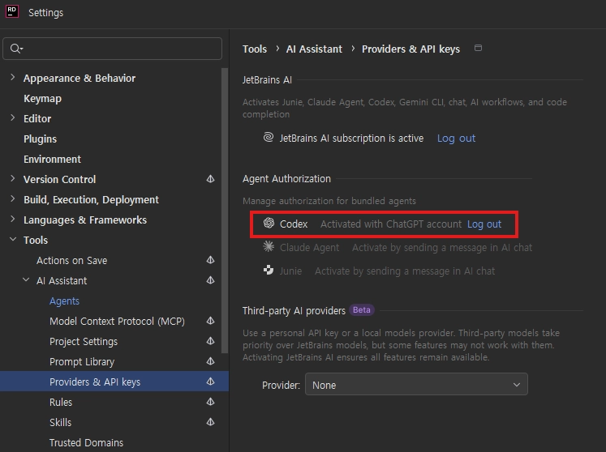

## :fireworks: CODEX는 4단계 스펙트럼을 도와줄 도구
- 2026 개발 조합  :  **Unity + Rider + GPT + Codex (Rider Official Plugins)**
  - :airplane: [Codex Official Docs](https://learn.chatgpt.com/docs)
  - :airplane: [Codex Is Now Integrated Into JetBrains IDEs](https://blog.jetbrains.com/ai/2026/01/codex-in-jetbrains-ides/?utm_source=chatgpt.com)
  - 

  

## :fireworks: CODEX 전용 관리 문서
- **AGENTS.md를 만들어서 세션마다 진행할 영구 프롬프트를 구성한다.**
  - 경로는 .codex 하단에 만들면 된다.
- **config.toml을 만들어서 CODEX에게 권한을 부여한다.**
  - 더 이상 권한을 묻지 않으므로 인터럽트가 걸리지 않는다.
  - :airplane:[config.toml](https://learn.chatgpt.com/docs/sandboxing?surface=app)
- :airplane:[CODEX 설정 팁](https://blog.naver.com/jhc9639/224186400602)

  

## :fire: sol 과 astra
- 체감상 astra가 토큰 3~5배 더 먹음.
- sol을 패고 싶은 순간에 astra를 켜자.

  

## :fire: 추론 수준 — 내가 언제 사용할까?
- **나의 기본값은 Medium. 구조 판단이나 어려운 오류에서 High 이상을 사용한다.**

| 수준 | 직관적인 선택 기준 | 내 프로젝트에서 사용할 때 |
| --- | --- | --- |
| Low | 해야 할 일이 명확하고 간단할 때 | :x: |
| Medium | 코드를 이해하며 작은 단위로 개발할 때 — 기본값 | 일반적인 구현 |
| High | 여러 흐름을 연결하고 설계를 판단할 때 | 복잡한 설계 및 내가 잘 모를 때 |
| xHigh | 원인을 찾기 어렵거나 여러 조건이 얽혔을 때 | High에서도 해결되지 않고, 더 기다려서라도 풀 가치가 있을 때만 |
| Max | 시간을 들여 넓은 범위를 종합 검토할 때 | :x: |
| Ultra | 지원 환경에서 가장 깊은 검토가 필요할 때 | :x: |

 

- :airplane: [OpenAI 추론 수준 안내](https://developers.openai.com/api/docs/guides/reasoning)
- :airplane: [Codex 서브에이전트와 추론 설정](https://learn.chatgpt.com/docs/agent-configuration/subagents)
