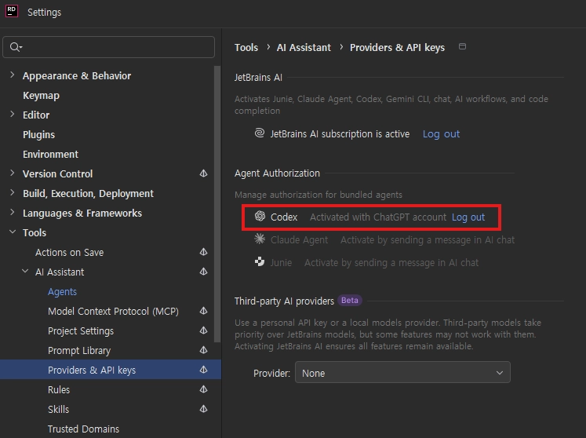

## :fireworks: CODEX는 4단계 스펙트럼을 도와줄 도구
- 2026 개발 조합  :  **Unity + Rider + GPT + Codex (Rider Official Plugins)**
  - :airplane: [Codex Official Docs](https://learn.chatgpt.com/docs)
  - :airplane: [Codex Is Now Integrated Into JetBrains IDEs](https://blog.jetbrains.com/ai/2026/01/codex-in-jetbrains-ides/?utm_source=chatgpt.com)
  - 

  

## :fireworks: CODEX 전용 관리 문서

#### :white_check_mark: `AGENTS.md`

- **AGENTS.md를 만들어서 세션마다 진행할 영구 프롬프트를 구성한다.**
  - 경로는 `.codex` 하단에 만들면 된다.

 

#### :white_check_mark: `config.toml`

- **config.toml을 만들어서 CODEX에게 권한을 부여한다.**
  - 더 이상 권한을 묻지 않으므로 인터럽트가 걸리지 않는다.
- :airplane: [config.toml](https://learn.chatgpt.com/docs/sandboxing?surface=app)
- :airplane: [CODEX 설정 팁](https://blog.naver.com/jhc9639/224186400602)

  

## :fireworks: 플랫폼 구분

#### ::cherry_blossom: 참고 사항
- **GPT_Web은 사용하지 않는다.  ->  GPT_App으로 통일한다.**
  - Chrome을 켜지 않으므로 빠른 듯?

> 공식적으로도 ChatGPT(chat & work)와 Codex의 대화 기록은 별도로 관리됩니다. 
> Work가 로컬 프로젝트를 읽을 수 있다고 해서 Codex의 과거 대화까지 자동으로 전달되는 것은 아닙니다.

 

#### :white_check_mark: GPT_Chat

- 일상 질문

 

#### :white_check_mark: GPT_Work

- 포트폴리오 문서 제작
- 개발 업무는 CODEX에서 하는 게 더 좋다. 그러므로 약간 애매한 녀석.
  - 개발자보다는 기획자에게 어울리는 툴.

 

#### :white_check_mark: CODEX_GPT APP

- 개발을 하지 않을 때(IDE Turn OFF) GitHub 문서를 복습 및 과외

 

#### :white_check_mark: CODEX_Rider_Main

- 개발, 설계, 코드 기반 과외를 모두 담당
- 평소에는 Main만 사용

 

#### :white_check_mark: CODEX_Rider_Sub (필요할 때 만)

- Main이 장시간 작업하는 동안 과외가 필요하면 Fork
- 분기 시점까지의 대화를 기반으로 학습
- 코드 수정 없이 분석과 설명 중심으로 활용
- 학습이 끝나면 세션 종료

 

#### :white_check_mark: JetBrain Junie Lite
  
- Codex 토큰 다 쓰면 사용할 무료 AI-Agent.

  

## :fireworks: 모델은?
- **나의 기본값은 최신 Sol**
- Sol이 컴퓨터 부수고 싶게 만들면 Astra로.

  

## :fireworks: 추론 수준 — 내가 언제 사용할까?
- **나의 기본값은 Medium. 구조 판단이나 어려운 오류에서 High 이상을 사용한다.**

| 수준 | 직관적인 선택 기준 | 내 프로젝트에서 사용할 때 |
| --- | --- | --- |
| Low | 해야 할 일이 명확하고 간단할 때 | :x: |
| Medium | 코드를 이해하며 작은 단위로 개발할 때 — 기본값 | 일반적인 구현 |
| High | 여러 흐름을 연결하고 설계를 판단할 때 | 복잡한 설계 및 내가 잘 모를 때 |
| xHigh | 원인을 찾기 어렵거나 여러 조건이 얽혔을 때 | High에서도 해결되지 않고, 더 기다려서라도 풀 가치가 있을 때만 |
| Max | 시간을 들여 넓은 범위를 종합 검토할 때 | :x: |
| Ultra | 지원 환경에서 가장 깊은 검토가 필요할 때 | :x: |

 

- :airplane: [OpenAI 추론 수준 안내](https://developers.openai.com/api/docs/guides/reasoning)
- :airplane: [Codex 서브에이전트와 추론 설정](https://learn.chatgpt.com/docs/agent-configuration/subagents)
