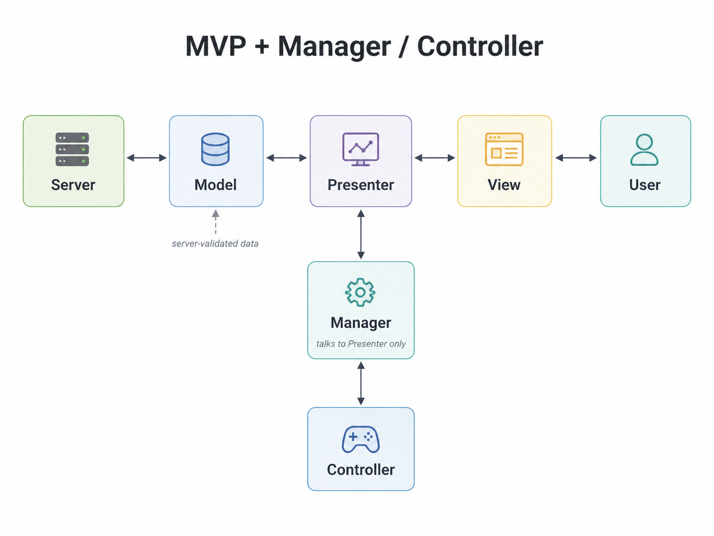
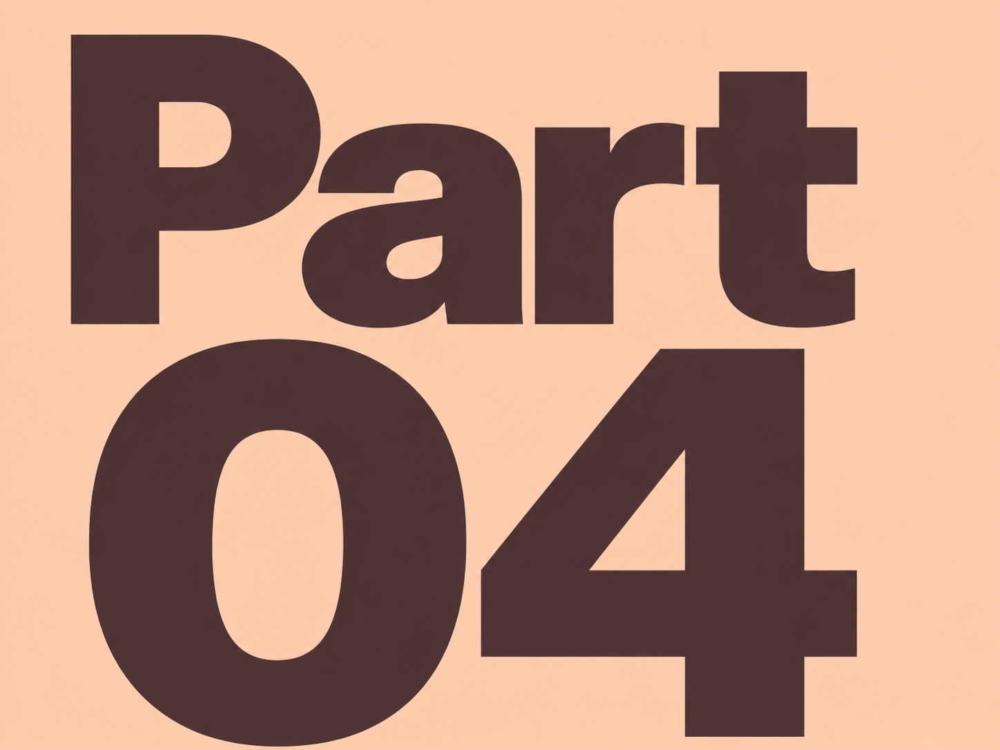

# 🎮 Part 3 &nbsp;:&nbsp; 직접 구현에서 AI 협업까지
### 2️⃣ 게임 전체 구조를 Model / View / Presenter / Manager / Controller 설계로.

#### 📌 설계도

  
  

    MVP + Manager / Controller 구조를 AI로 시각화한 이미지입니다.
  

- ✈️[GitHub_Unity_MVP Pattern](https://github.com/pjw960316/Unity_Client_Programmer/tree/main/1.%20Unity%20Programming/Unity%20Ver_2/MVP%20Pattern)

# 🎮 Part 3 &nbsp;:&nbsp; 직접 구현에서 AI 협업까지
#### 📌 각 계층에 대한 내용

- **Model**

  - 게임 오브젝트의 데이터를 관리하는 영역입니다.

  - 클라이언트 & 서버 구조에서는 서버의 검증된 데이터를 패킷으로 받기 때문에, 넓게 보면 서버의 영역에 가깝다고 생각했습니다.

  - 다만 클라이언트에서도 서버로부터 받은 데이터를 캐싱하거나 화면 갱신에 필요한 상태를 보관할 수 있으므로, 클라이언트 전용 Model도 필요하다고 보았습니다.

  - 중요한 것은 데이터가 View에 직접 전달되지 않고, Presenter를 통해 전달되어야 한다는 점이었습니다.

 

- **Presenter**

  - View와 Model은 서로를 직접 알지 않도록 했습니다.

  - View는 데이터를 필요로 하고, Model의 변경 사항은 화면에 반영되어야 하지만, 이 둘이 직접 대화하면 책임이 쉽게 섞인다고 생각했습니다.

  - 그래서 Presenter가 View와 Model 사이에서 데이터를 전달하고, View 갱신을 지시하는 중간 계층이 되도록 했습니다.

  - 또한 MVP가 결합된 하나의 게임 오브젝트 단위가 되도록 보았습니다. 필드 오브젝트나 UI처럼 실제 게임 안에 존재하는 단위는 Presenter를 통해 관리되고, 외부 Manager는 View나 Model이 아니라 Presenter와 대화하도록 했습니다.

 

- **View**

  - View는 사용자에게 보여지는 영역입니다.

  - 그래서 View가 게임의 상태 변경이나 흐름 제어까지 직접 담당하지 않도록 했습니다.

  - View는 Presenter에게 의존하고, Presenter의 명령을 받아 화면을 갱신하는 역할에 집중하도록 했습니다.

  - 직장에 있을 때 View가 많은 책임을 가진 구조로 구현했던 기억이 있습니다. UI가 켜져 있을 때는 기능이 정상적으로 동작했지만, 몇 개월 뒤 해당 UI가 꺼졌을 때 관련 기능까지 동작하지 않는 문제를 뒤늦게 발견한 적이 있었습니다.

  - 그 경험 이후 View는 최대한 “보여주는 영역”으로 제한해야 한다고 느꼈습니다.

# 🎮 Part 3 &nbsp;:&nbsp; 직접 구현에서 AI 협업까지

- **Manager**

  - 필드 오브젝트가 여러 개 존재하면, 이들을 한곳에서 관리하는 주체가 필요했습니다.

  - 예를 들어 하나의 오브젝트를 클릭했을 때 타겟을 바꾸고, 이전 타겟의 상태를 되돌리는 흐름은 개별 View가 담당하기보다 Manager가 담당하는 편이 자연스럽다고 생각했습니다.

  - 게임에는 여러 Singleton Manager가 존재할 수 있고, Manager끼리는 필요한 경우 대화할 수 있습니다.

  - 다만 Manager가 개별 MVP 객체와 대화할 때는 View나 Model을 직접 건드리지 않고 Presenter와만 대화하도록 방향을 잡았습니다.

 

- **Controller**

  - Manager가 MonoBehaviour를 직접 상속하면 Unity 의존성이 커진다고 생각했습니다.

  - 그래서 Unity에서 직접 동작해야 하는 입력 처리, Raycast, MonoBehaviour 기반 기능은 Controller에서 담당하도록 했습니다.

  - 반대로 Manager는 가능한 한 C# 영역에서 게임 흐름과 상태 변경을 담당하도록 분리했습니다.

  - 즉, Controller는 Unity 세상에서 필요한 데이터를 가공하고, Manager는 그 데이터를 바탕으로 게임의 흐름을 결정하는 구조를 목표로 했습니다.

 

# 🎮 Part 3 &nbsp;:&nbsp; 직접 구현에서 AI 협업까지

#### 📌 코드 예시

~~~c#
public class PresenterManager : ManagerBase<PresenterManager>
{
  private readonly HashSet<PresenterBase> _livedPresenterHashSet = new();

  public void CreatePresenter<TPresenter>(IView view) 
  where TPresenter : PresenterBase, new()
  {
    var presenter = new TPresenter();

    presenter.Initialize(view);
    presenter.SetView();
    presenter.BindEvent();

    _livedPresenterHashSet.Add(presenter);
  }

  public void TerminatePresenter(PresenterBase presenter)
  {
    if (_livedPresenterHashSet.Contains(presenter))
      _livedPresenterHashSet.Remove(presenter);
  }
}

// Presenter 클래스의 이벤트 메서드
private void OnChangeSparrowSpinState(Unit _)
{
  _fieldObjectSparrow.ChangeAnimalSpeedZero();
  _animalData.ChangeAnimalState(EAnimalState.SPIN);
  _animalData.BlockChangeState();

  Observable.Timer(TimeSpan.FromSeconds(SPIN_SECOND)).Subscribe(_ =>
  {
    _animalData.AllowChangeState();

    _fieldObjectSparrow.ChangeAnimalPath(QUARTER_ROTATION);
    _animalData.ChangeAnimalState(EAnimalState.WALK);
  }).AddTo(_disposable);
}
~~~
- PresenterManager를 통해서 Presenter를 생성합니다. [Factory Pattern]
- OnChangeSparrowSpinState() 내부에서 _fieldObjectSparrow는 View고, _animalData는 Model입니다.
- Presenter가 View와 Model 사이에서 상태 변경과 화면 동작의 흐름을 조율합니다.

# 🎮 Part 3 &nbsp;:&nbsp; 직접 구현에서 AI 협업까지

### 3️⃣ 하나를 고치기 위해 여러 스크립트를 읽어야 했던 기존 방식에서 벗어나고 싶었습니다.

#### 📌 의존성과 책임

- Manager와 Controller를 분리하면서 처음에는 서로를 필드로 들고 있는 구조로 구현했습니다. Manager도 Controller를 알고, Controller도 Manager를 알고 있으니 구현은 쉬웠습니다. 필요한 메서드를 바로 호출할 수 있었기 때문입니다.

- 하지만 시간이 지날수록 이 구조는 서로를 강하게 의존하게 만든다고 느꼈습니다. 하나를 고치기 위해 다른 스크립트까지 함께 읽어야 했고, 변경의 주체가 누구인지 흐려질 수 있었습니다.

- 그래서 Manager와 Controller의 책임을 다시 나누었습니다. Manager는 MVP로 구성된 객체들에게 필요한 정보를 전달하고, 게임 흐름과 상태 변경을 관리하는 역할을 맡았습니다. Controller는 Unity 세상에서 Manager가 필요로 하는 입력, Raycast, 위치 정보 같은 데이터를 가공해 전달하는 역할로 제한했습니다.

- 이 구조에서는 Controller가 여러 외부 객체에 직접 노출되지 않고, Manager를 통해 제어되도록 제한됩니다. 어디서든 Controller를 직접 건드릴 수 있으면 변경 지점이 쉽게 퍼지지만, Manager를 통해서만 흐름이 바뀌면 변경의 주체를 추적하기 쉬워진다고 생각했습니다.

- 결과적으로 목표는 “서로 편하게 호출하는 구조”가 아니라, “각자의 책임이 있고 변경의 주체가 제한되는 구조”였습니다. 아직 완벽하게 의존성을 끊은 구조는 아니지만, 최소한 어떤 클래스가 무엇을 책임지는지 더 분명하게 볼 수 있게 되었습니다.

 

#### 📌 클래스와 메서드의 책임

- 의존성을 줄이려고 하다 보니 자연스럽게 클래스의 책임도 다시 보게 되었습니다. 처음에는 하나의 클래스가 여러 일을 처리하는 편이 빠르지만, 시간이 지나면 그 클래스가 무엇을 책임지는지 흐려집니다.

- 예를 들어 참새 View는 참새를 화면에 보여주고, 간단한 이동이나 애니메이션을 처리할 수 있습니다. 하지만 유저의 입력을 해석하고, 어떤 참새가 선택되었는지 판단하고, 이전 선택 대상을 되돌리는 흐름까지 View가 담당하는 것은 적절하지 않다고 생각했습니다.

- 그래서 유저 입력 처리는 InputManager와 Controller 쪽의 책임으로 두고, 필드 오브젝트의 선택 상태 변경은 FieldObjectManager가 담당하도록 나누었습니다. View는 자신에게 전달된 상태를 화면에 반영하는 역할에 집중하도록 했습니다.

- 이 과정을 통해 클래스의 책임을 나누면 코드가 단순히 쪼개지는 것이 아니라, “이 기능은 어디에 있어야 하는가?”를 판단하는 기준이 생긴다는 것을 느꼈습니다.

# 🎮 Part 3 &nbsp;:&nbsp; 직접 구현에서 AI 협업까지

### 4️⃣ Rx와 event를 기능 동작이 아니라 노출 범위와 책임 기준으로 보게 되었습니다.

#### 📌 Rx를 과하게 사용했던 경험

- 과거에는 UniRx를 제대로 이해하고 사용했다기보다, Subscribe하고 OnNext를 호출하면 기능이 동작한다는 이유로 많이 사용했습니다. 기능은 돌아갔지만, 흐름이 많아질수록 어디서 이벤트가 발생하고 어디서 상태가 바뀌는지 추적하기 어려워졌습니다.

- 인턴을 마친 뒤 첫 업무 중 하나가 팀 전체의 UniRx, Action, MonoObserver, Observable 관련 코드를 정리하는 일이었습니다. 당시에는 이 작업의 의미를 충분히 이해하지 못했습니다. 지금 돌아보면 팀장님의 의도는 단순히 Rx 문법을 정리하라는 것이 아니라, Event System의 흐름과 의존성을 이해하라는 것이었다고 생각합니다.

- 혼자 개발하면서 과거에 UI 단에서 남발했던 public UniRx 흐름들이 얼마나 위험했을지 다시 보이기 시작했습니다. 기능이 동작하는 것과 변경 지점이 안전하게 관리되는 것은 다른 문제였습니다.

 

#### 📌 event와 Action을 다시 보게 된 이유

- 예전에는 Action 앞에 왜 event를 붙이는지 깊게 이해하지 못했습니다. 하지만 지금은 이것이 단순한 문법 차이가 아니라, 외부에 허용할 수 있는 행위를 제한하는 장치라고 이해하고 있습니다.

- public Action은 외부에서 구독할 수도 있지만, 직접 호출할 수도 있습니다. 반면 event는 외부에서 구독과 해제는 가능하지만 직접 호출할 수 없습니다. 즉, 이벤트의 실행 주체를 외부에 넘기지 않는다는 점에서 차이가 있습니다.

- 지금은 Rx가 항상 나쁜 것도 아니고, event나 Action이 항상 좋은 것도 아니라고 생각합니다. 중요한 것은 어떤 도구를 쓰느냐보다, 누가 이벤트를 발생시킬 수 있고, 누가 구독만 할 수 있으며, 어디까지 외부에 노출해도 안전한지를 판단하는 것입니다.

 

# 🎮 Part 3 &nbsp;:&nbsp; 직접 구현에서 AI 협업까지

### 5️⃣ 디자인패턴은 책으로 외운 이론이 아니라, 구현 중에 필요성을 느낀 구조였습니다.

#### 📌 과거에 바라본 디자인패턴

- 학교나 회사에 있을 때도 디자인패턴 책은 여러 번 샀습니다. 하지만 매번 싱글턴, 옵저버처럼 익숙한 패턴만 눈으로 읽고 넘어갔고, 새로운 패턴도 예제만 보면 절실함이 없어서 “이론이구나” 정도로 받아들였습니다.

- 파트장님께서 디자인패턴은 이론적으로 공부하는 것이 아니라, 구현하다 보면 어느덧 사용하고 있는 자신을 바라보는 것이라고 말씀하신 적이 있습니다. 당시에는 그 말을 제대로 이해하지 못했습니다. 하지만 직접 구조를 만들고 삽질해보니, 이제는 그 의미를 조금 이해하게 되었습니다.

  

#### 📌 구현하다가 패턴을 뒤늦게 이해한 경험

- 예를 들어 View가 생성될 때마다 Presenter를 누가 연결하고 관리해야 하는지 고민했습니다. 매번 직접 생성하고 연결하면 생성과 해제의 관리가 어려워질 수 있다고 생각했고, PresenterManager가 View 생성 시점에 Presenter를 생성하고 연결하는 구조를 만들었습니다. 나중에 돌아보니 이 구조는 Factory Pattern과 닮아 있었습니다.

- 입력 처리에서도 비슷한 고민을 했습니다. 입력의 종류가 늘어날수록 if-else가 계속 늘어나는 구조가 되었고, “입력은 다르지만 결국 입력을 처리한다는 기능은 동일하지 않은가?”라는 생각을 하게 되었습니다.

- 그래서 입력 종류마다 Handler를 분리하고, 입력 데이터와 Handler를 매핑하는 방식으로 바꾸려 했습니다. 분기는 완전히 사라지지 않지만, 분기 이후의 처리 책임을 각 Handler로 나누면 확장에 더 유리하다고 생각했습니다. 이 과정에서 Strategy Pattern의 필요성을 체감했습니다.

 

# 🎮 Part 3 &nbsp;:&nbsp; 직접 구현에서 AI 협업까지

#### 📌 게임을 통해 느낀 패턴의 의미

- 전략 게임에서 상위 랭크를 달성했을 때, 실력이 늘어난 이유를 돌아보면 결국 복잡해 보이는 상황을 몇 가지 패턴으로 정리했기 때문이라고 생각합니다. 상황마다 자주 반복되는 형태를 요약하고, 그 상황에 가까운 해답을 찾는 과정을 반복했습니다.

- 이 경험은 개발에서도 비슷하게 느껴졌습니다. 개발 상황도 겉으로는 매번 달라 보이지만, 추상적으로 보면 비슷한 문제 상황이 반복됩니다. 예전에는 매번 비슷한 상황에서 비슷하게 실수했지만, 이제는 그 문제에 대응하는 구조를 고민하게 되었습니다.

- ✈️[게임 연구 문서](https://persistent-hoverfly-e3c.notion.site/2d929daafd6680ae88c8f6777bea51bd)

  

#### 📌 디자인패턴도 결국 Trade-off라고 느꼈습니다.

- 부족하지만 내부 구조를 직접 구현하려고 많이 삽질했습니다. 그러다 보니 구현을 많이 하지 못하고 설계에 머문 시간도 있었습니다. 하지만 그 과정에서 클래스 구조의 확장성 문제, 의존성 방향, 자료구조 선택, 상속 구조, 다형성 적용 방식을 직접 마주할 수 있었습니다.

- 예전에는 개발 과정 없이 책만 읽었기 때문에 디자인패턴이 잘 와닿지 않았습니다. 하지만 제가 삽질하며 도달한 구조를 책에서 다시 찾아보니, 특정 디자인패턴과 닮아 있다는 것을 알게 되었고, 제가 겪은 문제와 비교하며 이해할 수 있었습니다.

- 그러면서 디자인패턴도 정답이 아니고 대단한 기법만은 아니라는 것을 알게 되었습니다. 결국 모두 장단점이 있고, 상황에 따라 선택해야 하는 Trade-off라고 생각합니다.

- 분기를 줄이고 싶어서 Strategy Pattern을 적용하면 구조가 복잡해질 수 있고, Observer Pattern으로 의존성을 줄이면 흐름 추적과 디버깅이 어려워질 수 있습니다. 그래도 이런 문제를 계속 의식하면서 개발하면, 결국 저만의 판단 기준과 패턴이 생긴다고 생각합니다.

- ✈️[GitHub_디자인 패턴](https://github.com/pjw960316/Unity_Client_Programmer/tree/main/1.%20Unity%20Programming/Design%20Pattern)

# 🎮 Part 3 &nbsp;:&nbsp; 직접 구현에서 AI 협업까지

#### 📌 코드 예시

~~~c#
public enum EInput
{
  MOVE,
  TOUCH,
  TOUCH_POS
}

public interface IInputHandler
{
  void HandleInput(InputAction.CallbackContext context);
}

public class TouchHandler : IInputHandler
{
  private readonly Action _onResult;

  public TouchHandler(Action action)
  {
    _onResult = action;
  }

  public void HandleInput(InputAction.CallbackContext context)
  {
    if (!context.canceled)
    {
      return;
    }

    _onResult.Invoke();
  }
}

public class TouchPosHandler : IInputHandler
{
  private readonly InputController _inputController;

  public TouchPosHandler(InputController inputController)
  {
    _inputController = inputController;
  }

  public void HandleInput(InputAction.CallbackContext context)
  {
    var pos = context.ReadValue<Vector2>();
    _inputController.UpdateCurMousePosition(pos);
  }
}
~~~

~~~c#
private readonly Dictionary<EInput, IInputHandler> _handlerDict = new();

private void InitializeInputActionDictionary()
{
  foreach (var kv in _inputActionDict)
  {
    var enumKey = kv.Value;
    _handlerDict[enumKey] = GetHandler(enumKey);
  }
}

public void OnHandleInput(InputAction.CallbackContext context)
{
  if (context.phase == InputActionPhase.Performed ||
      context.phase == InputActionPhase.Canceled)
  {
    var inputEnum = GetInputEnum(context);
    var handler = _handlerDict[inputEnum];

    handler.HandleInput(context);
  }
}

private IInputHandler GetHandler(EInput eInput)
{
  switch (eInput)
  {
    case EInput.MOVE:
      return new MoveHandler();
    case EInput.TOUCH:
      return new TouchHandler(OnTouch);
    case EInput.TOUCH_POS:
      return new TouchPosHandler(this);
  }

  return null;
}
~~~

- 입력 종류가 늘어날 때마다 InputController 내부의 if-else가 비대해지는 문제를 줄이기 위해, 입력 처리 책임을 IInputHandler로 분리했습니다. [Strategy Pattern]

- InputController는 입력 타입을 판별하고, 실제 처리 방식은 각 Handler가 담당하도록 구성했습니다.

- 분기 자체를 완전히 없애기보다, 분기 이후의 처리 책임이 한 클래스에 몰리지 않도록 나누는 것을 목표로 했습니다.

# 🎮 Part 3 &nbsp;:&nbsp; 직접 구현에서 AI 협업까지

### 6️⃣ 달라진 점과 아직 남은 한계 그리고 개발 후기

#### 📌 달라진 점

- 예전에는 기능을 만들고 나서도 “왜 이렇게 만들었는지”가 오래 남지 않았습니다. 기능이 동작하면 구현을 끝냈고, 시간이 지나면 그 코드가 어떤 판단으로 만들어졌는지 설명하기 어려웠습니다.

- 지금은 코드를 작성할 때 “왜 이 클래스에 있어야 하는가?”, “왜 이 메서드가 public이어야 하는가?”, “왜 이 흐름은 Manager를 거쳐야 하는가?”를 더 자주 생각하게 되었습니다. 단순히 기능을 만드는 것이 아니라, 변경 지점과 책임의 위치를 함께 고민하게 되었습니다.

- 회사에서 보았던 구조들도 예전과 다르게 보이기 시작했습니다. 예전에는 시니어 분이 만든 Input FSM을 보고 “왜 이렇게 어렵게 만들었을까?” 정도로 생각했다면, 지금은 입력 기기가 늘어나고 상태가 복잡해질수록 FSM이 왜 필요했는지 이해할 수 있게 되었습니다.

- 이전에는 내 업무가 아니라고 생각했던 구조도, 이제는 “언젠가 내가 맡게 된다면 왜 필요한지부터 이해하고 접근할 수 있겠다”고 느끼게 되었습니다. 이것이 가장 큰 변화였습니다.

 

#### 📌 아직 남은 한계

- 반대로 과한 설계의 위험도 느꼈습니다. 좋은 구조를 만들고 싶다는 생각이 강해지다 보니, 작은 시스템에도 필요 이상으로 구조를 나누고, 오히려 가독성을 해치는 순간도 있었습니다.

- 아직 모든 디자인패턴의 필요성을 체감한 것은 아닙니다. 어떤 패턴은 여전히 책으로 읽어도 절실하게 와닿지 않습니다. 다만 이제는 그것을 모른다고 끝내기보다, 아직 그 문제 상황을 충분히 겪지 않았기 때문이라고 생각합니다.

- 그래서 지금의 목표는 완벽한 구조를 한 번에 만드는 것이 아닙니다. 기능을 구현하면서 책임이 흐려지는 지점, 의존성이 강해지는 지점, 변경이 어려워지는 지점을 발견하고, 그때마다 더 나은 구조로 고쳐가는 것입니다.

 

#### 📌 개발 후기
- 이직을 위한 보여주기식 게임보다, 제가 실제로 쓸 수 있는 기능을 만들고 싶었습니다.

- 그래서 생활에 필요한 기능들을 게임 안에 넣어보고 있고, 현재는 그중 알람 기능을 유용하게 사용하고 있습니다.

- 앞으로는 몬스터를 잡으며 영어 단어를 외우는 단어장 기능처럼, 제가 필요한 기능들을 꾸준히 추가해 볼 계획입니다.

- ✈️[GitHub_Toy Project](https://github.com/pjw960316/HabitGame)

::: chapter-page

  

  

    🛤️ Part 4 : 다시 일하기 위한 저만의 지도
  

:::