

  <h1 style="font-size: 60px; margin: 0 0 36px 0;">
    박지원 포트폴리오
  </h1>

  

    Unity / C# Client Programmer
  

  

    2026
  

# 👤 이력서

 

## ✅ 기본 정보

- 이름  :  박지원
- 성별  :  남
- 생년월일  :  1996.03.16
  
- 🏠  :  서울특별시 동대문구 장안동
- 📫  :  pjw960316@naver.com
- 🔗  :  ✈️[Github](https://github.com/pjw960316/Unity_Client_Programmer)

  

## ✅ 학력
- **숭실대학교 컴퓨터학부**
  - 2016.03 ~ 2022.02 : 컴퓨터학부 학사
  - 2017.04 ~ 2019.01 : 군 복무

  

## ✅ 경력
- **넥슨게임즈 넥토리얼 & 정규직**
  - 2022.12 ~ 2024.04 : 제우스 프로젝트_Unity 클라이언트 프로그래머
    
    - ✈️[Project ZEUS / GODSOME](https://www.nexongames.co.kr/en/game/project_zeus_en.php)
    
    - ✈️[GODSOME Official Trailer](https://www.youtube.com/watch?v=h6JmOxkbqqI)

 

- **펄어비스 인턴**
  - 2021.12 ~ 2022.02 : 플랫폼 프로그래밍 2팀

# 🧩 목차

 

## 🪞 PROLOGUE &nbsp;:&nbsp; 퇴사 이후 돌아본 저의 네 가지 문제점

    

## 🤖 Part 1 &nbsp;:&nbsp; AI와 함께하는 개발

    

## 📝 Part 2 &nbsp;:&nbsp; 기록을 제 것으로 만드는 공부

    

## 🎮 Part 3 &nbsp;:&nbsp; 직접 구현에서 AI 협업까지
 
    

## 🛤️ Part 4 &nbsp;:&nbsp; 다시 일하기 위한 저만의 지도

    

## 🌱 후기

::: chapter-page

  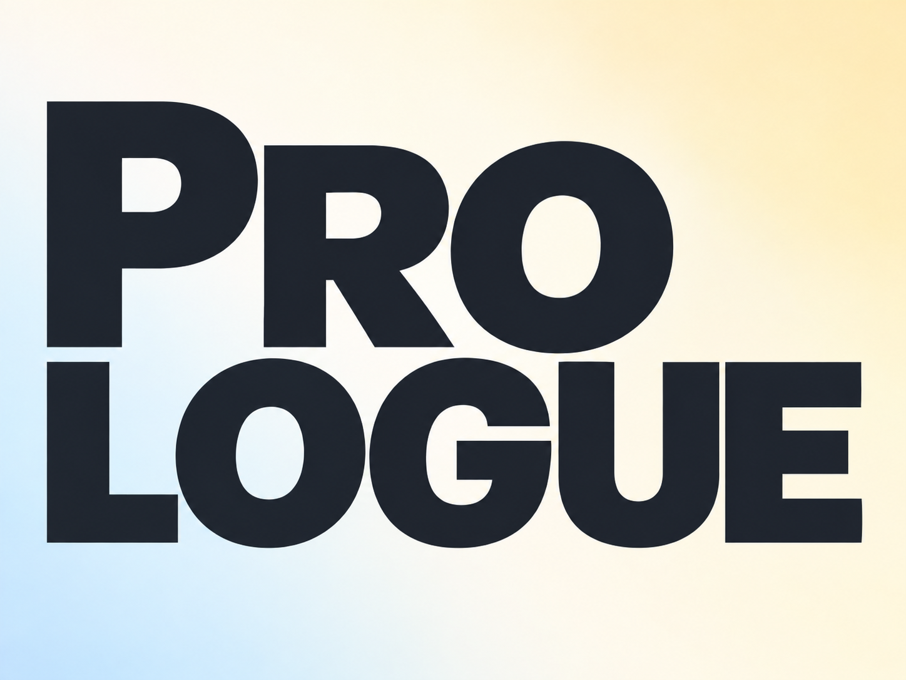

  

    🪞 PROLOGUE : 퇴사 이후 돌아본 저의 네 가지 문제점
  

:::

# 🪞 PROLOGUE &nbsp;:&nbsp; 퇴사 이후 돌아본 저의 네 가지 문제점

### 1️⃣ 퇴사 직전 면담 때, '혼자 슈팅게임을 만들 수 있느냐?' 에서   저는 '아니요'라고 답했습니다.

  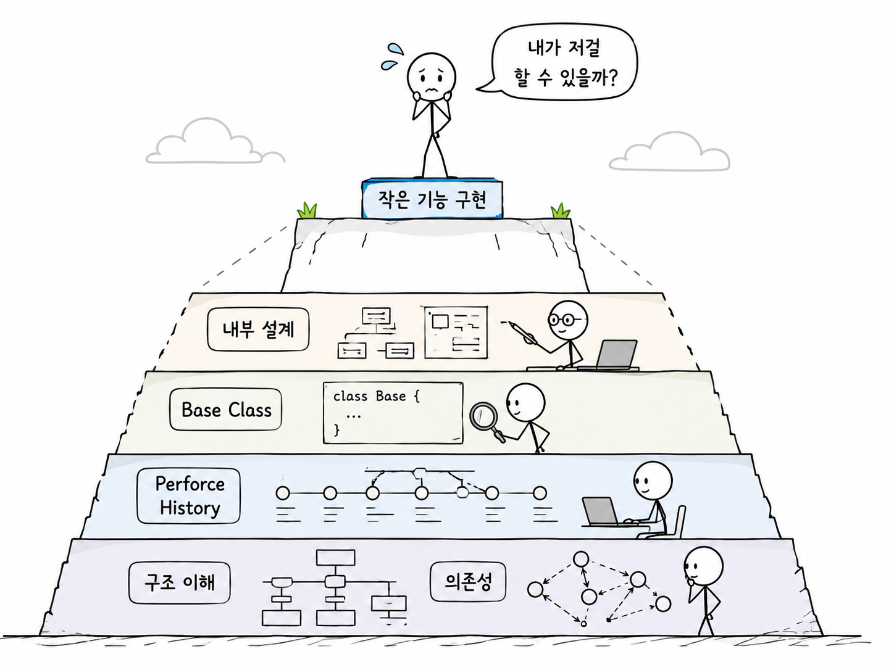

  

   업무 상황을 재구성한 AI 이미지입니다.
  

  

- 코드의 밑바닥 설계부터 구현할 자신이 없었습니다. 

 

- 팀에서 제게 요구했던 것은 단순히 메서드를 빠르게 생산하는 것이 아니라,   기존 코드의 흐름과 기반 구조를 이해한 뒤 그 위에 기능을 올리는 일이었습니다.

 

- 그러나 기반 구조를 충분히 이해하지 못한 상태에서 기능 구현에만 조급해졌고,   그 결과 중복 코드와 복잡한 의존성을 만들었습니다.   돌이켜보면 이 문제는 인턴 시절부터 어렴풋이 알고 있었지만, 제대로 마주하지 못했던 부분이었습니다.

 

# 🪞 PROLOGUE &nbsp;:&nbsp; 퇴사 이후 돌아본 저의 네 가지 문제점

### 2️⃣ 꾸준히 실력을 쌓기보다, 조급하게 증명하려 했습니다.

  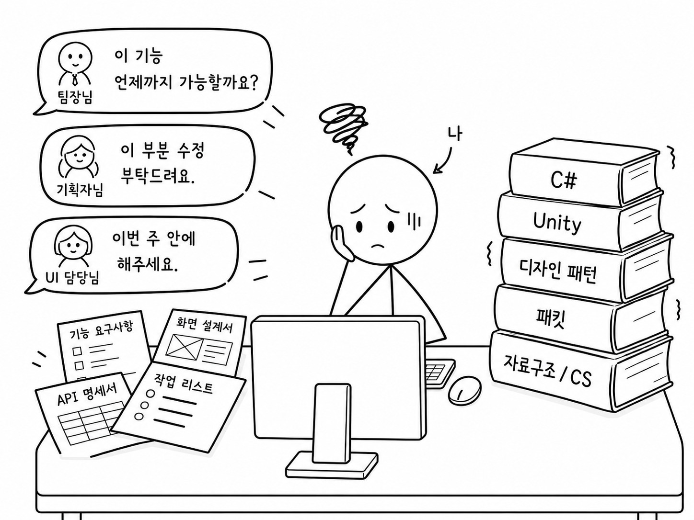

  

   업무 상황을 재구성한 AI 이미지입니다.
  

  

- 멘토님과 팀장님께 “왜 이렇게 조급하냐”는 피드백을 여러 번 들었습니다.  태스크를 수행할 때 기존 코드의 흐름을 깊게 파악하고 안정적으로 완성하기보다,  우선 돌아가게 만드는 데 급했습니다.  더 어려운 태스크를 맡아 1인분을 할 수 있다는 것을 증명하고 싶었습니다.

 

- 하지만 어려운 태스크를 맡자, 제 기본기의 빈틈이 한꺼번에 드러났습니다.   하나씩 채우기보다 모두 제대로 알아야 한다는 부담에 눌려, 오히려 부족함을 피했습니다.

 

- 결국 저에게 필요했던 것은 거창한 계획이나 빠른 증명이 아니라,  채워야 할 공부를 작게 나누고 하나씩 꾸준히 쌓는 태도였습니다.

# 🪞 PROLOGUE &nbsp;:&nbsp; 퇴사 이후 돌아본 저의 네 가지 문제점

### 3️⃣ 메모만 하고 기록으로 가공하여 제 것으로 만든 적이 적었습니다.

  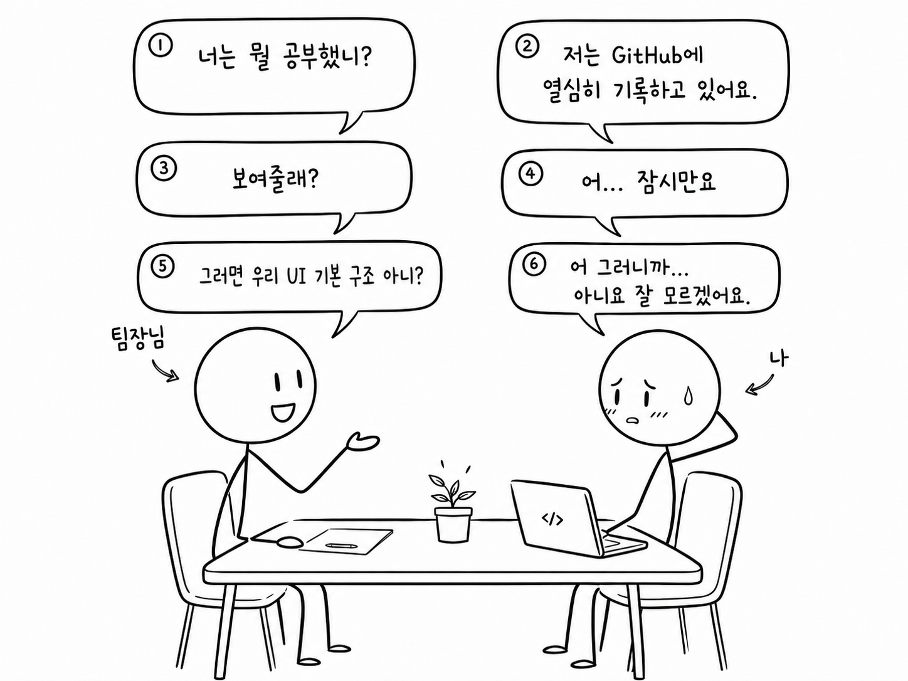

  

    팀장님과의 중간평가에서 있었던 일화를 간단히 시각화한 AI 이미지입니다.
  

  

- 당시에도 공부를 하지 않은 것은 아니었습니다. 다만 제대로 된 공부를 하지 못했습니다.

 

- 배운 내용을 적기는 했지만, 다시 읽고 설명할 수 있는 형태로 만들지 못했고,   결국 지식이 제 안에 쌓이기보다 메모장 안에만 쌓였습니다.

 

- 이 경험을 통해 공부는 ‘적는 것’에서 끝나는 것이 아니라,   다시 읽히고 설명 가능한 기록으로 가공되어야 한다는 문제의식을 갖게 되었습니다.

 

# 🪞 PROLOGUE &nbsp;:&nbsp; 퇴사 이후 돌아본 저의 네 가지 문제점

### 4️⃣ 회사에만 집중하다 보니 제 자신을 돌보지 못했습니다.

  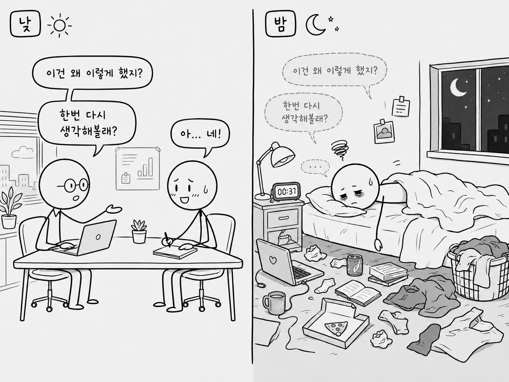

  

    간단히 시각화한 AI 이미지입니다.
  

  

- 게임 회사에 들어가는 것은 오랜 목표였고, 저는 그 목표를 비교적 이른 시기에 이뤘습니다.  하지만 그 이후에는 제 삶의 중심이 점점 저 자신보다 회사에 맞춰졌고,  잘하고 싶은 마음이 커질수록 오히려 저를 돌보는 기준은 약해졌습니다.

 

- 직장 생활에서 여러 번 흔들리는 순간이 있었지만,  그때마다 감정을 정리하고 다시 일상으로 돌아오는 방식이 부족했습니다.  결국 회사 생활을 지속하기 위한 체력과 정신력을 제 삶 안에서 관리하지 못했습니다.

 

- 퇴사 이후에는 회사에서 인정받는 방법보다,  제가 어떤 상태에서 꾸준히 개발하고 일할 수 있는지를 먼저 돌아보기 시작했습니다.
  

::: chapter-page

  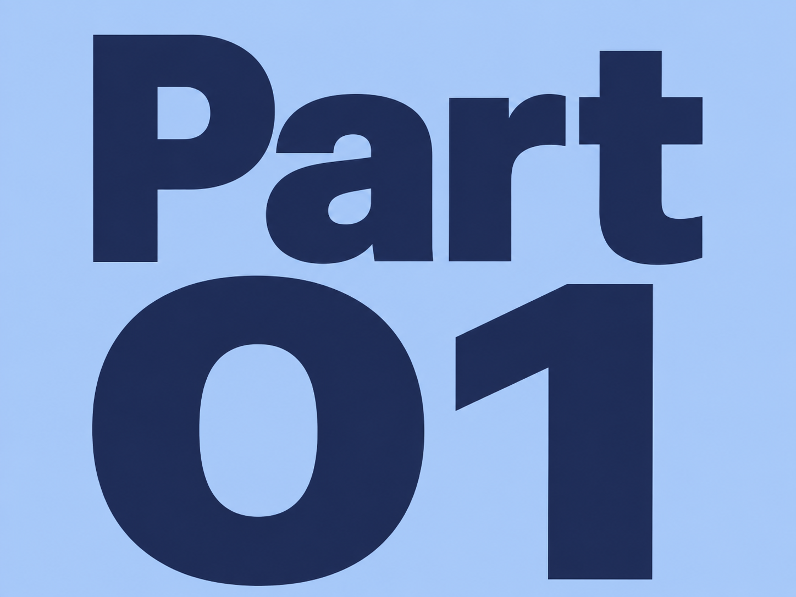

  

    🤖 Part 1 : AI와 함께하는 개발
  

:::

# 🤖 Part 1 &nbsp;:&nbsp; AI와 함께하는 개발

  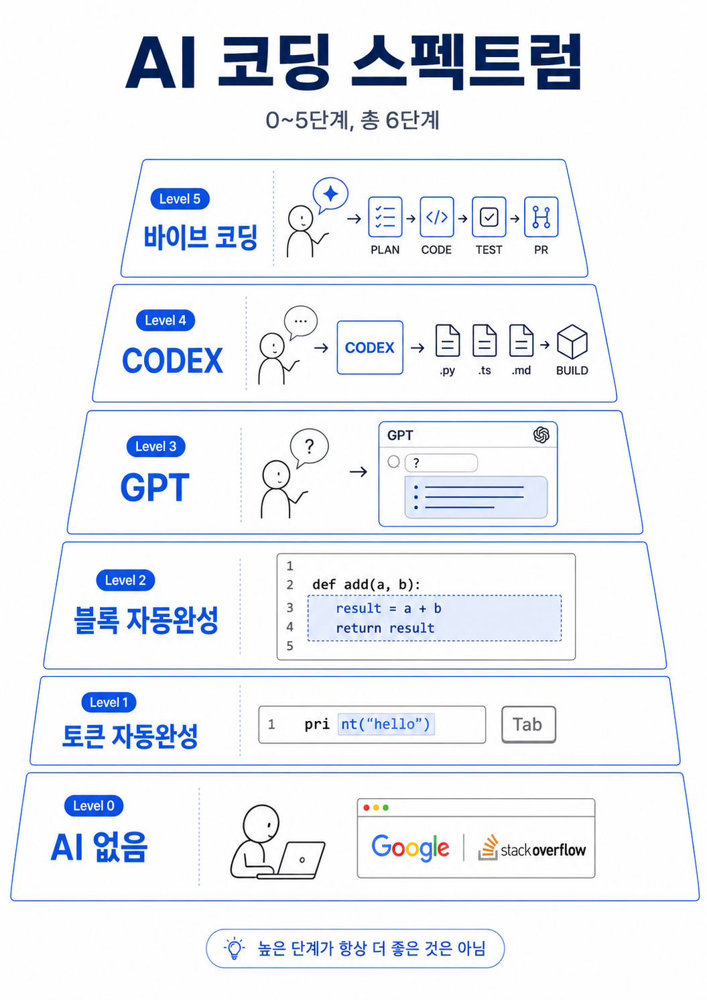

# 🤖 Part 1 &nbsp;:&nbsp; AI와 함께하는 개발

### 1️⃣ Level_0 ~ Level_2  :  AI가 없던 시절, 구글링과 <>로 학습을 했던 시절.

  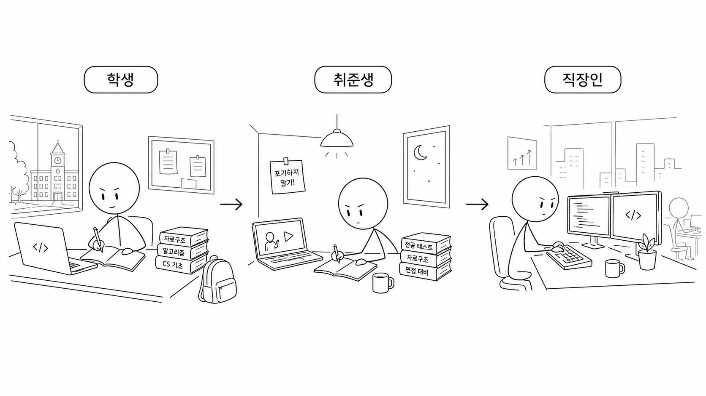

- 넥슨게임즈에서는 클라이언트 팀 동료에게 질문하고 기존 코드의 호출 흐름을 추적하며   프로젝트 구조 안에서 직접 기능을 구현하고 문제를 해결했습니다.

- 실무에서 부족함을 느꼈던 구현 능력을 보완하기 위해 C#으로 코딩테스트를 다시 준비하고,   Jeffrey Richter의 『CLR via C#』을 바탕으로 언어와 런타임의 기초부터 다시 공부했습니다.

- 2026년 서술형 필기시험에서 외부 도구 없이 컴퓨터공학 지식을 직접 작성하며   과거보다 개념의 원인과 동작 과정을 깊이 설명할 수 있게 되었음을 확인했습니다.

 

  

    
    
재직 시절 기록한 업무 우선순위

  

  

    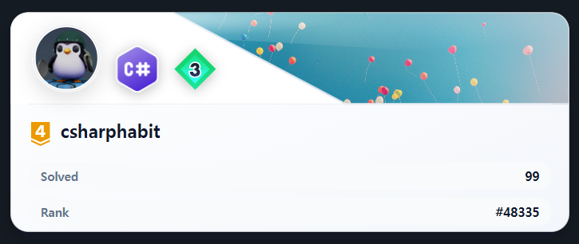
    
2026년 백준 골드 4 달성

  

- ✈️[GitHub_CLR via C# 학습 기록](https://github.com/pjw960316/Unity_Client_Programmer/tree/main/1.%20Unity%20Programming/C%23%20Ver_2)
- ✈️[GitHub_C# 코딩테스트 소스코드 모음](https://github.com/pjw960316/Algorithm-Habit)

# 🤖 Part 1 &nbsp;:&nbsp; AI와 함께하는 개발

### 2️⃣ Level_3  :  GPT와 함께 기초를 다시 공부하면서 이해를 기반으로 구현하는 개발자
#### 회사 재직  /  퇴사 이후 2025년

  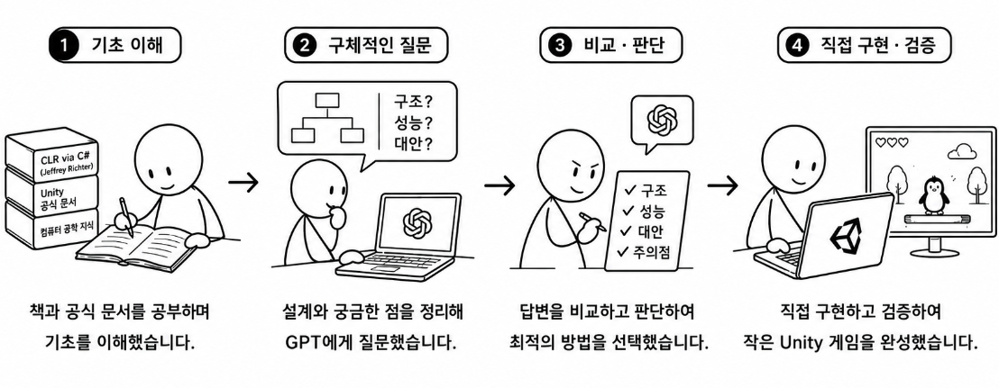

 

- 회사에서는 기존 코드의 흐름을 따라 기능을 구현했지만   당시에는 코드가 동작하는 원인과 내부 비용까지 충분히 이해하지 못한 채 구현했던 경험이 있었습니다.

- 2025년에는 『CLR via C#』과 Unity 공식 문서를 GPT와 함께 공부하며   코드의 동작 원인과 설계 대안, 성능·메모리 차이까지 질문하고 이해의 빈 곳을 채웠습니다.

- 기초지식이 쌓일수록 더 구체적인 질문을 만들고 답변의 타당성을 판단할 수 있었으며   이를 직접 구현하고 검증해 작은 Unity 게임을 처음부터 끝까지 완성했습니다.

 

  

    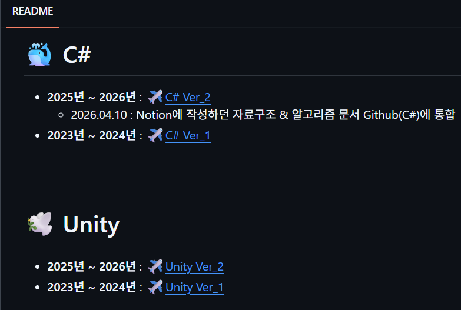
    

      2023년부터 관리한 Unity 개발자 학습 기록   1,700회 이상 커밋
    

  

  

    
    

      Codex없이 직접 구현하고 완성한   1인 Unity 프로젝트
    

  

- ✈️[GitHub_유니티 개발자 공부](https://github.com/pjw960316/Unity_Client_Programmer)
- ✈️[GitHub_1인 유니티 프로젝트](https://github.com/pjw960316/HabitGame)

# 🤖 Part 1 &nbsp;:&nbsp; AI와 함께하는 개발

### 3️⃣ Level_4  :  질문과 코드 보조를 넘어, 구현 단위를 AI에게 맡기기 시작했습니다.
#### 2026년 현재

  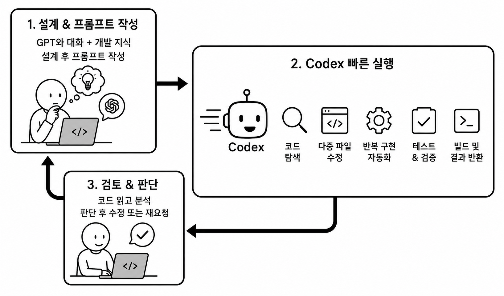

- 경험상 위임하기 좋은 내용

# 🤖 Part 1 &nbsp;:&nbsp; AI와 함께하는 개발

### 4️⃣ 결국, AI와 함께하는 개발은 겉으로는 새로운 방식처럼 보이지만   본질적으로는 직장에서 시니어 개발자분들과 함께하던 페어 프로그래밍과 같다고 생각합니다.

 

  

::: chapter-page

  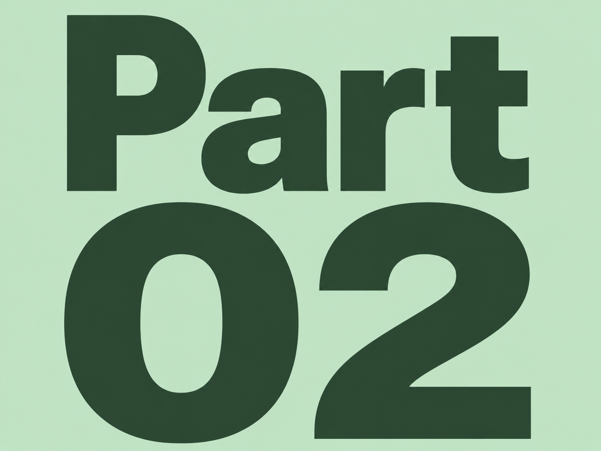

  

    📝 Part 2 : 기록을 제 것으로 만드는 공부
  

:::

# 📝 Part 2 &nbsp;:&nbsp; 기록을 제 것으로 만드는 공부

### 1️⃣ 다시 읽지 않는 메모는 제 것이 되지 않았습니다.

  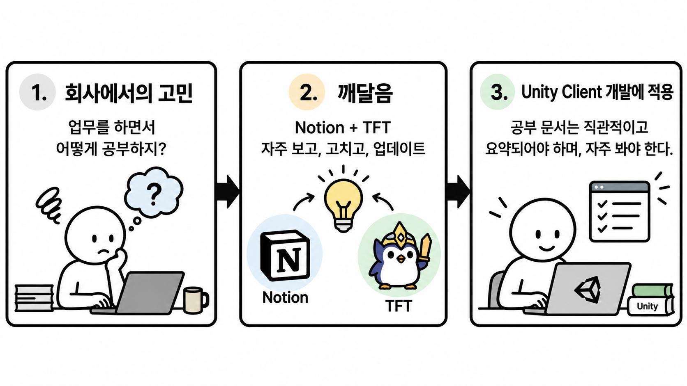

- 돌이켜보면 회사에서 정직원이 된 뒤 가장 어려웠던 것은   업무를 하면서도 계속 공부하고 성장하는 방법을 만드는 일이었습니다.

 

- 업무 중 생긴 모든 의문을 그 자리에서 깊게 공부할 수는 없었고   길게 남긴 수 많은 메모들 결국 다시 읽지 않게 되었습니다.

 

- 퇴사 이후에는 이 문제를 계속 고민했습니다.   Notion과 TFT에서 얻은 경험을 바탕으로   지금은 개발 과정의 배움을 다시 제 판단 기준으로 남기는 방식을 만들고 있습니다.

# 📝 Part 2 &nbsp;:&nbsp; 기록을 제 것으로 만드는 공부

### 2️⃣ 기록은 다시 읽고 고치면서 제 것이 되었습니다.

  

  

    2023년의 메모는 첨부한 이미지보다도 훨씬 길게 적었습니다.
  

  

- **2023년 ~ 2024년 회사 생활**
  - 좋은 내용을 많이 적었지만, 길어진 메모는 결국 다시 읽지 않았습니다.
  
  - 이렇게 다시 보지 않은 메모가 수백 개 쌓였습니다.
  
  - 돌아보면 당시에는 메모를 남기는 데 집중했고, 다시 읽을 수 있는 기록으로 가공하지 못했습니다.

 

- **현재**
  - 당시의 긴 메모를 지금 사용 중인 월간 계획표 형식으로 다시 가공했습니다.
  
  - 중요한 내용은 매일 볼 수 있는 위치에 두고 반복해서 읽습니다.
  
  - 다시 볼 때마다 고치고 줄이며, 실제로 사용할 수 있는 짧은 기록으로 정제합니다.

# 📝 Part 2 &nbsp;:&nbsp; 기록을 제 것으로 만드는 공부

### 3️⃣ 반복해서 고친 기록이 실제 판단 기준이 되었습니다.

  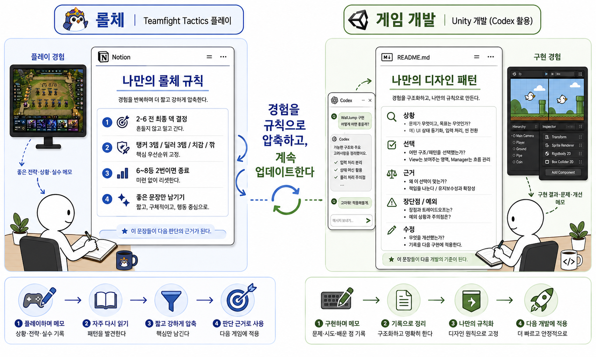

 

- 롤토체스를 하며 저만의 전술집을 만들었고, 게임을 할 때마다 계속 읽고 고치며 더 짧고 직관적인 기준으로 정리했습니다.

- 그 기록을 실제 판단 기준으로 사용하고, 결과를 복기해 다시 수정하는 과정을 반복하면서 상위 랭커까지 올라갔습니다.

- 이 경험을 통해 자주 보고 자주 고친 기록이 결국 나만의 판단 기준이 되고, 그것이 실력을 만든다는 것을 체감했습니다.

  

    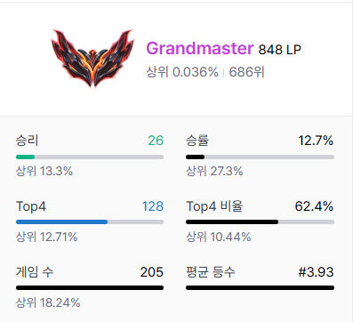
    

      상위 0.036% 달성
    

  

# 📝 Part 2 &nbsp;:&nbsp; 기록을 제 것으로 만드는 공부

### 4️⃣ Codex와 개발하며 배운 내용을 제 언어의 기록으로 남깁니다.

  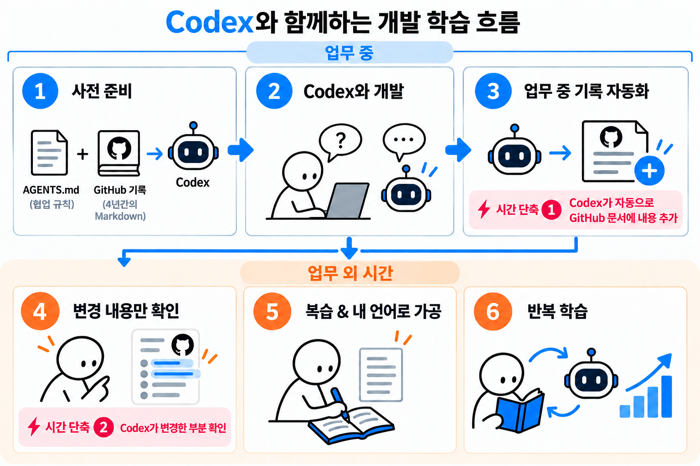

- **업무 중**
  - Codex가 AGENTS.md와 기존 GitHub 기록을 읽은 상태에서 개발하고 합니다.

  - 새로 나온 개념과 설계 기준을 공부 문서에 자동으로 추가합니다. 

  - 이 덕분에 문서를 직접 찾고 정리하는 시간이 줄어 개발 흐름을 끊지 않을 수 있습니다.

 

- **업무가 끝나고**
  - 업무가 끝난 뒤에는 제가 Codex가 자동으로 추가한 내용과 변경 기록만 확인합니다. 

  - 전체를 처음부터 다시 정리하지 않고 필요한 부분만 추적할 수 있어, 여기서도 복습에 드는 시간을 줄일 수 있습니다.

 

- **Notion과 TFT에서 배운 부분**
  - 하지만 1~3번의 자동화까지만 하면 결국 AI가 만든 기록일 뿐이라 제 공부가 되지 않았습니다. 
  
  - 가장 중요한 것은 5~6번처럼 다시 읽고 제 언어로 고쳐 판단 기준으로 만들고,   그 기록을 이후의 저와 Codex가 다시 참고하는 반복 과정입니다.

# 📝 Part 2 &nbsp;:&nbsp; 기록을 제 것으로 만드는 공부

### 5️⃣ AI 덕분에 복습과 판단에 더 집중할 수 있게 되었습니다.

- 많이 메모하는 것보다   **기록을 수 없이 고치고 다시 읽고**   저의 것으로 만드는 과정이 공부라는 것을 알게 되었습니다.

 

- 하지만 직장 생활을 하면서 이 과정을 모두 직접 하기에는 시간과 에너지가 부족했습니다.   지금은 Codex가 문서를 찾고, 내용을 추가하고, Markdown 형식을 정리하는 과정을 도와줍니다.   공부에 들어가는 부수적인 시간을 크게 줄여주고 있습니다.

 

- 덕분에 저는 Codex가 만든 초안을 다시 읽고, **제 언어로 다듬으며 복습하는 과정**에 집중하면 됩니다.   이 정도의 시간은 현실적으로 꾸준히 투자할 수 있었습니다.   실제로 반복하면서 계속 이어갈 수 있는 공부 방법이라는 확신이 생겼습니다.

  

> 4년 동안 혼자 쌓아온 GitHub 기록을 Codex가 읽고 제 설계 기준을 참고하기 시작했을 때, 
> 그동안 계속 기록해온 시간이 헛되지 않았다는 생각이 들었습니다.

 

- ✈️[GitHub_나만의 디자인 패턴](https://github.com/pjw960316/Unity_Client_Programmer/tree/main/1.%20Unity%20Programming/Design%20Pattern)

::: chapter-page

  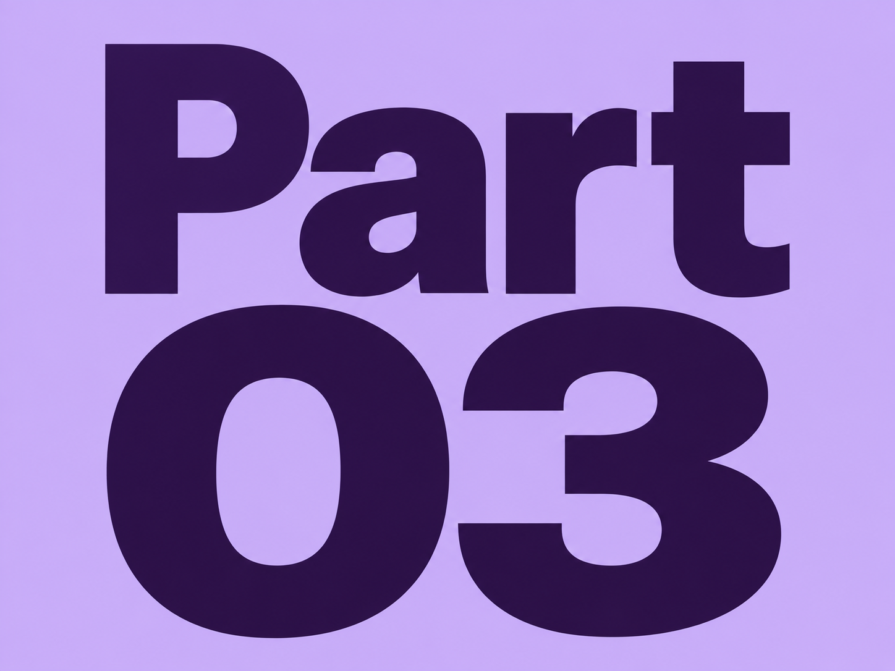

  

    🎮 Part 3 : 직접 구현에서 AI 협업까지
  

:::

# 🎮 Part 3 &nbsp;:&nbsp; 직접 구현에서 AI 협업까지

#### 3장 방향성

- 〈박지원 키우기〉를 개발하면서 내가 배운 핵심 세 가지를 뽑는다. 각 글을 읽고 나면 내가 어떤 상황에서 어떤 결정을 내리는지 하나씩 남아야 한다.
각 배움 안에서 변화가 보이게 쓴다. 회사에서 겪은 문제 → GPT에 질문하며 직접 구현하면서 얻은 판단 기준 → Codex와 개발하면서 그 기준을 적용한 결과. 회사 경험은 짧게 두고, 직접 구현하며 생각이 바뀐 지점에 가장 많은 분량을 쓴다.

- Codex와 작업한 경험에서는 내 판단을 구체적으로 적는다. 내가 먼저 정한 것, 맡긴 것, 결과를 보고 확인하거나 고친 것을 구분한다. 1·2장에서 이야기한 AI 활용과 공부 방식이 실제 개발에서 어떤 선택으로 이어졌는지 보여준다.

- 게임은 실제 화면과 한 문장으로 소개한다. 각 글에는 그 판단을 확인할 수 있는 코드 변경, 커밋, 실행 결과 중 하나를 붙인다. MVP나 클래스 구조는 그 선택을 이해하는 데 필요한 만큼만 설명한다.

- 월요일 첫 작업은 후보 세 개를 적는 것. 각 후보 옆에 ‘예전에는 어떻게 했나’, ‘지금은 무엇을 다르게 결정하나’, ‘그 차이가 실제 코드 어디에 남아 있나’를 한 줄씩 써본다.

### 1️⃣

# 🛤️ Part 4 &nbsp;:&nbsp; 다시 일하기 위한 저만의 지도

### 1️⃣ 2024년은 살면서 처음으로 방향을 잃었고   앞으로 어떻게 살아갈지 고민했던 시기였습니다.

  

 

- 퇴사 시기에 실장님과 파트장님, 친척형 모두 비슷한 이야기를 해주셨습니다.   다시 회사에 가기 전에 더 단단해지고, 앞으로 삶을 어떻게 살아갈지 충분히 고민해보라는 조언이었습니다.

 

- 퇴사 후 몇 달 동안 거의 집에서 나가지 않았습니다.   혼자 있는 시간이 길어지면서 제 밑바닥을 마주했고, 오히려 어느 순간 모든 것이 담담하게 느껴졌습니다.   그러던 중 친구가 불암산에 가보자고 제안했고 오랜만에 집을 나섰습니다.    올라가는 동안 서른 번 가까이 쉬었지만,   여기서 포기하면 다시 집 밖으로 나오지 못할 것 같아 끝까지 걸었고 결국 정상에 올랐습니다.  
그날을 계기로 다시 한번 열심히 살아보기로 했습니다.    그리고 2년 뒤 다시 찾은 불암산은 한 번도 쉬지 않고 정상까지 올라갔습니다.

 

- 이후에는 바로 취업 준비를 하기보다 책을 많이 읽었습니다.   건강, 운동, 마음, 삶에 대해 공부하며 앞으로 어떻게 살아갈지 제 기준부터 하나씩 정리했습니다.

# 🛤️ Part 4 &nbsp;:&nbsp; 다시 일하기 위한 저만의 지도

### 2️⃣ 2025년은 루틴을 하나씩 만들어갔고   제가 어떤 개발자가 되고 싶은지 알아가던 시기였습니다.

  

    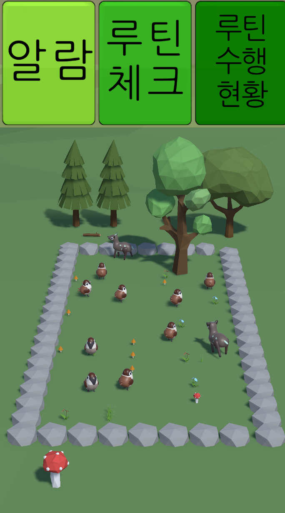
    

      개발한 게임 화면
    

  

  

    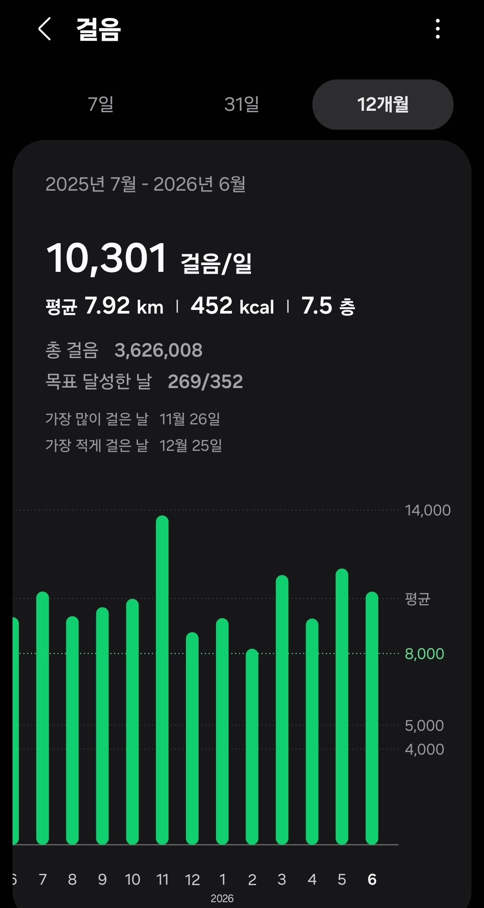
    

      12개월 걷기 루틴
    

  

  

    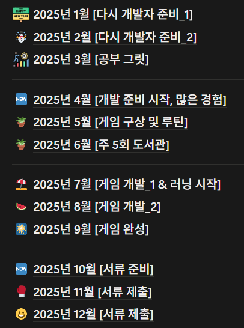
    

      Notion 월간 계획 기록
    

  

 

- 과거에는 생각과 계획만 많았습니다. 그러나 점차 작은 것도 꾸준히 하는 습관의 가치를 알게 되었습니다. 

 

- 매일 8천 보를 걷기 시작했습니다. 그 습관은 지금도 이어지고 있으며,   ‘손목닥터’ 앱으로 100원씩 버는 일도 지금까지 제게 소소한 즐거움으로 남아 있습니다.

 

- 운동도 거창하게 시작하지는 않았지만, 조금씩 꾸준히 이어가기 시작했습니다.

 

- 다시 개발자로 살아보려고 노력하자, 두려움도 조금씩 줄어들었습니다.   주에 2번 간신히 가던 도서관도 3번, 4번으로 점점 늘어났습니다.

 

- 개발도 무엇부터 해야 할지 몰라 처음부터 천천히 다시 시작했습니다.   한동안 손도 대지 못했던 게임 개발도 다시 이어가며, 완성 리비전을 묶게 되었습니다.

# 🛤️ Part 4 &nbsp;:&nbsp; 다시 일하기 위한 저만의 지도

### 3️⃣ 2026년은 만든 루틴을 꾸준히 실행하고 고치며   저만의 지도를 강화하고 있는 시기입니다.

  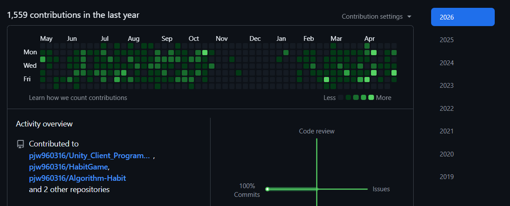

  

    2025년 11월 ~ 2026년 1월은 이직 서류 준비, 필기 시험 준비를 병행하던 시기입니다.   
    돌아보면 이 시기에도 게임 개발을 완전히 놓지 않았어야 했습니다.   
    이후에는 개발 기록과 학습 기록이 끊기지 않도록 루틴을 다시 정리했습니다.
    

 

- 매일 8시에 일어나 9시에 도서관에 갑니다.   이제는 주중에는 하루도 빠짐없이 나가고 있습니다. 일단 나가면 뭐라도 한 가지 이상 배우게 됩니다.

 

- 2025년에 아쉬웠던 루틴들을 2026년에는 하나씩 달성해 나가고 있습니다.

 

- 이직에도 계속 도전하고 있습니다. 많이 탈락했고, 그때마다 여전히 슬프기도 합니다.   하지만 이제는 맛있는 음식을 먹고, 자전거를 타고, 일찍 자면서 훌훌 털어낼 수 있게 되었습니다.   예전처럼 감정에 오래 휘둘리기보다, 다시 다음 날의 루틴으로 돌아오는 힘이 생겼습니다.

 

- 저는 정재승 작가의 『열두 발자국』에서 말하는 “자신만의 지도”라는 표현을 좋아합니다.   오늘 하기로 한 일을 꾸준히 해나가다 보면 많은 시행착오를 겪게 됩니다.   그 과정에서 제가 어떤 사람인지 알아가는 시간이 생겼고, 조금씩 나아질 수 있었습니다.   저는 그 시간이 저만의 지도를 그리는 과정이라고 생각합니다.

# 🌱 후기

 

- 이제는 슈팅 게임을 혼자 만들 수 있습니다.

 

- 하지만 혼자서 할 수 있는 일에는 한계가 있고, 좋은 팀 안에서 배울 수 있는 것들이 훨씬 많습니다.

 

- 그래서 이제는 과거의 부족함을 발판 삼아, 조금 더 단단해진 모습으로 다시 팀 안에서 도전해보고 싶습니다.

 

  <h1 style="
    font-size: 42px;
    font-weight: 700;
    margin: 0;
    line-height: 1.4;
  ">
    긴 시간 읽어주셔서 감사합니다!
  </h1>

