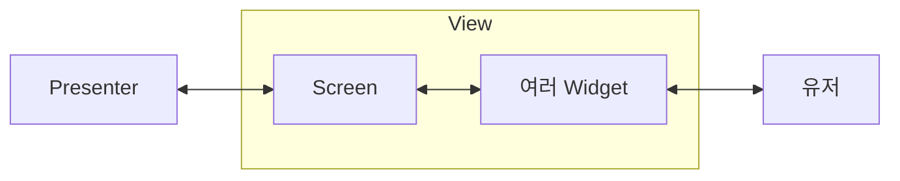

## :fire: View 라는 개념은 Screen 과 Widget으로 쪼갤 수 있다.

#### :white_check_mark: 구조도

 

#### :white_check_mark: 경험

- 팝업도 버튼도 같은 View인데, 둘을 설명할 때 내가 말하는 View의 범위가 모호했다.
- 출금 확인을 예로 들면 유저의 손이 닿는 곳은 **확인 버튼**이고,   Presenter가 확인 결과를 받는 곳은 **확인 팝업**이다. 
- 이 차이를 기준으로 게임 UI의 View를 두 단위로 나눠 본다.

 

#### :white_check_mark: 기능을 담는 Screen과 개별 요소인 Widget

- **Screen (Large View)** 은 Presenter와 가장 가까운 View다. 보통 여러 Widget을 들고 있다.
- **Widget (Small View)** 은 유저와 가장 가까운 View다. 
  - 유저가 누르는 확인 버튼, 읽는 포인트 표시, 선택하는 아이템 슬롯처럼 개별 입력이나 표시를 맡는다.
- Large와 Small은 **맡은 역할의 범위**를 가리킨다. 
  - 작은 확인 팝업도 ‘출금할지 확인한다’는 기능 전체를 담으므로 Screen이다. 
  - 인벤토리 창 대부분을 차지하는 스크롤 목록도 그 안에서 아이템 목록 표시를 맡으면 Widget이다.

  

## :fire: Widget은 Presenter를 두지 않는다.

- 내가 정한 설계 원칙.

  

## :fireworks: Widget을 별도 Prefab으로 분리하는 기준 

- 같은 구성의 Widget을 여러 곳에 배치하거나 목록에서 반복 생성할 때는 별도 Prefab으로 두면 편하다. 
- 한 Screen에서만 쓰는 Widget은 그 Screen의 자식 GameObject로 두어도 된다.
- Prefab은 GameObject의 구성을 저장하고 다시 사용하는 방법이므로 **Screen과 Widget 모두** Prefab으로 만들 수 있다. 